<div align="center">

<a href="https://sarshijkarn.com.np"></a>

<br>

<a href="https://sarshijkarn.com.np"></a>
<a href="https://sarshijkarn.com.np/assets/Sarshij-Karn-Resume.pdf"></a>
<a href="https://www.linkedin.com/in/sarshij-karn-1a7766236/"></a>
<a href="https://youtube.com/@sarshij"></a>
<a href="https://x.com/realsarshij"></a>
<a href="https://www.instagram.com/sarshij"></a>


<br><br>

</div>

<div align="center">

<picture>
  <source media="(prefers-color-scheme: dark)" srcset="https://raw.githubusercontent.com/sarshij/sarshij/output/github-snake-dark.svg">
  <source media="(prefers-color-scheme: light)" srcset="https://raw.githubusercontent.com/sarshij/sarshij/output/github-snake.svg">
  
</picture>

</div>


<h2 align="center">About</h2>


<br>


<h2 align="center">Stack</h2>

```text
      ╷ ╷ ╷ ╷ ╷ ╷ ╷ ╷           sarshij@nepal
  ┌───┴─┴─┴─┴─┴─┴─┴─┴───┐       ─────────────
──┤                     ├──     Languages  Python · C/C++ · JavaScript · TypeScript
──┤    S A R S H I J    ├──     Frontend   React · Next.js · Vite · HTML/CSS
──┤   ░▒▓█ 0x8F2A █▓▒░  ├──     AI/ML      TensorFlow · PyTorch · OpenCV · MediaPipe
──┤   BEI · NCE · T.U.  ├──     Embedded   Arduino · MCUs · circuit sim · PCB design
──┤                     ├──     Security   Linux · Kali · networking · automation
  └───┬─┬─┬─┬─┬─┬─┬─┬───┘       Shell      Bash · PowerShell
      ╵ ╵ ╵ ╵ ╵ ╵ ╵ ╵           Host       Acer Nitro V 16 · Ryzen 7 8845HS · RTX 4050
```


<table>
<tr>
<td><b>Languages</b></td>
<td></td>
</tr>
<tr>
<td><b>Web</b></td>
<td></td>
</tr>
<tr>
<td><b>AI / ML</b></td>
<td>   </td>
</tr>
<tr>
<td><b>Embedded</b></td>
<td>  </td>
</tr>
<tr>
<td><b>Security + OS</b></td>
<td></td>
</tr>
<tr>
<td><b>Workflow</b></td>
<td></td>
</tr>
</table>


<details>
<summary><code>./achievements.sh</code></summary>
<br>

- Startup Hackathon 2025, theme "AI for Social Impact and Scale" (The Startup Network, Embark College and PHDCCI)
- Full merit scholarship at National College of Engineering
- Merit-based scholarship at Liverpool International College
- Grade X: GPA 4.00
- Cracked the engineering entrance exam on the first attempt
- Cloud Computing and Python Programming trainings at NCE

</details>


<div align="center">


</div>


<details>
<summary><code>cat secret.txt</code></summary>
<br>

If you scrolled this far, you read READMEs for fun. We'll get along.

</details>

<br>


