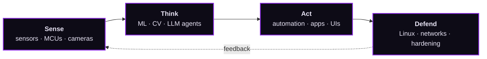

<div align="center">

<a href="https://sarshijkarn.com.np"></a>

<br>

<a href="https://sarshijkarn.com.np"></a>
<a href="https://sarshijkarn.com.np/assets/Sarshij-Karn-Resume.pdf"></a>
<a href="https://www.linkedin.com/in/sarshij-karn-1a7766236/"></a>
<a href="https://youtube.com/@sarshij"></a>
<a href="https://x.com/realsarshij"></a>
<a href="https://www.instagram.com/sarshij"></a>

<br><br>

<a href="#about"><kbd> about </kbd></a>
<a href="#stack"><kbd> stack </kbd></a>
<a href="#projects"><kbd> projects </kbd></a>
<a href="#now"><kbd> now </kbd></a>
<a href="#telemetry"><kbd> telemetry </kbd></a>
<a href="#connect"><kbd> connect </kbd></a>

<br><br>


</div>


<h2 align="center">About</h2>


<br>

I'm an electronics engineering student in Kathmandu who likes the spot where hardware meets software. I build things that see, decide and protect: computer vision tools, AI screeners, privacy utilities, and the occasional circuit. Hackathons, books, sports and the markets keep the rest of me busy.


<h2 align="center">Stack</h2>

```text
      ╷ ╷ ╷ ╷ ╷ ╷ ╷ ╷           sarshij@nepal
  ┌───┴─┴─┴─┴─┴─┴─┴─┴───┐       ─────────────
──┤                     ├──     Languages  Python · C/C++ · JavaScript · TypeScript
──┤    S A R S H I J    ├──     Frontend   React · Next.js · Vite · HTML/CSS
──┤   ░▒▓█ 0x8F2A █▓▒░  ├──     AI/ML      TensorFlow · PyTorch · OpenCV · MediaPipe
──┤   BEI · NCE · T.U.  ├──     Embedded   Arduino · MCUs · circuit sim · PCB design
──┤                     ├──     Security   Linux · Kali · networking · automation
  └───┬─┬─┬─┬─┬─┬─┬─┬───┘       Shell      Bash · PowerShell
      ╵ ╵ ╵ ╵ ╵ ╵ ╵ ╵           Host       Acer Nitro V 16 · Ryzen 7 8845HS · RTX 4050
```

How I think about building anything:



<table>
<tr>
<td><b>Languages</b></td>
<td></td>
</tr>
<tr>
<td><b>Web</b></td>
<td></td>
</tr>
<tr>
<td><b>AI / ML</b></td>
<td>   </td>
</tr>
<tr>
<td><b>Embedded</b></td>
<td>  </td>
</tr>
<tr>
<td><b>Security + OS</b></td>
<td></td>
</tr>
<tr>
<td><b>Workflow</b></td>
<td></td>
</tr>
</table>


<h2 align="center">Projects</h2>

<table>
<tr>
<td width="50%" valign="top">

### [ClearHire](https://github.com/sarshij/ClearHire-AI-Resume-Screener)
AI resume screener. Matches candidates to roles with SBERT, handles bulk screening for multiple recruiters, and flags fake or AI-written resumes.

`Python` `SBERT` `NLP`

</td>
<td width="50%" valign="top">

### [FaceShield](https://github.com/sarshij/Faceshield)
Privacy tool that detects, tracks and blurs faces in video. Runs fully on your own machine, so footage never leaves it.

`MediaPipe` `DeepSORT` `Web app`

</td>
</tr>
<tr>
<td width="50%" valign="top">

### [MedAssist](https://github.com/sarshij/medassist)
Medical assistant for rural communities. Symptom analysis, voice interaction, English and Nepali, report analysis and offline first-aid guides.

`Python` `Voice` `Offline-first`

</td>
<td width="50%" valign="top">

### [SmartVault](https://github.com/sarshij/smart-vault-text-and-photo-notes-app)
Private notes for text and photos behind a local PIN vault, with optional AI image enhancement through Gemini.

`React` `TypeScript` `Vite`

</td>
</tr>
<tr>
<td width="50%" valign="top">

### [HyperQR](https://github.com/sarshij/hyperqr-all-in-one-qr-code-utility)
QR toolkit. Create or scan from camera and images, auto-connect to WiFi, batch-process hundreds of files, export history to CSV.

`Python` `Desktop UI`

</td>
<td width="50%" valign="top">

### [Sync](https://lnkd.in/p/g-pPifWb)
Self-hosted Android fleet management for authorised MDM setups. Live location, device diagnostics and secure file sync, deployed with zero-touch setup.

`Android` `Self-hosted` `MDM`

</td>
</tr>
</table>

<details>
<summary><code>ls -a ~/projects</code>   (4 more)</summary>
<br>

| Project | What it does |
|---|---|
| [Gesture Calculator](https://github.com/sarshij/gesture-based-calculator) | Do arithmetic with your hand in front of a webcam. Fingers pick numbers, thumb distance picks the operator, and it speaks the answer. |
| [Emotion Detection](https://github.com/sarshij/emotion-detection-model) | Reads facial expressions in real time with OpenCV and deep learning. |
| [Reddit Data Scraper](https://github.com/sarshij/reddit-data-scraper) | Pulls posts and comments from a subreddit starting at any year. Fast with API keys (PRAW), slower but keyless without them. |
| [WhatsApp Automation Tool](https://github.com/sarshij/whatsapp-automation-king-pro) | Desktop app for bulk and scheduled messaging from Excel lists, with attachments and group support. |

</details>

<details>
<summary><code>./achievements.sh</code></summary>
<br>

- Startup Hackathon 2025, theme "AI for Social Impact and Scale" (The Startup Network, Embark College and PHDCCI)
- Full merit scholarship at National College of Engineering
- Merit-based scholarship at Liverpool International College
- Grade X: GPA 4.00
- Cracked the engineering entrance exam on the first attempt
- Cloud Computing and Python Programming trainings at NCE

</details>


<h2 align="center">Now</h2>

```text
[~] rebuilding sarshijkarn.com.np into an interactive, multi-world portal
[~] a JARVIS-style local assistant that runs on my own machine
[~] a stock-market bot for NEPSE
[~] a free streaming platform for Nepali films, and ways to back indie filmmakers
[~] new videos on the Sarshij YouTube channel
[ ] your idea here
```


<h2 align="center">Telemetry</h2>

<div align="center">

<picture>
  <source media="(prefers-color-scheme: dark)" srcset="https://raw.githubusercontent.com/sarshij/sarshij/output/github-snake-dark.svg">
  <source media="(prefers-color-scheme: light)" srcset="https://raw.githubusercontent.com/sarshij/sarshij/output/github-snake.svg">
  
</picture>

<br>


</div>


<h2 align="center">Connect</h2>

<div align="center">

Collabs, internships, freelance work, or just a good book recommendation: the fastest way to reach me is the contact form on my site.

<a href="https://sarshijkarn.com.np/#contact"></a>

</div>

<details>
<summary><code>cat secret.txt</code></summary>
<br>

If you scrolled this far, you read READMEs for fun. We'll get along.

</details>

<br>


