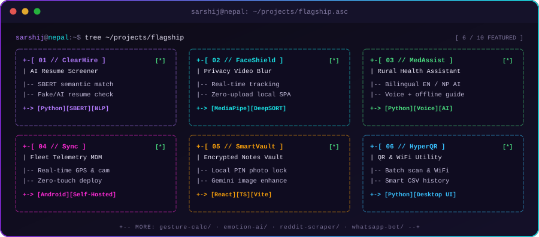

 

  

<picture>
  <source media="(prefers-color-scheme: dark)" srcset="https://raw.githubusercontent.com/sarshij/sarshij/output/github-snake-dark.svg">
  <source media="(prefers-color-scheme: light)" srcset="https://raw.githubusercontent.com/sarshij/sarshij/output/github-snake.svg">
  
</picture>

<h2 align="center">About</h2>

 

<!-- ░░░ STACK ░░░ -->

<h2 align="center">Stack</h2>

<!-- ░░░ IDENTITY / ASCII PORTRAIT & DOSSIER ░░░ -->

<h2 align="center">Identity</h2>

<!-- ░░░ PROJECTS ░░░ -->

<h2 align="center">Builds</h2>

<!-- ░░░ ACHIEVEMENTS ░░░ -->

<h2 align="center">Achievements</h2>

<!-- ░░░ STATS ░░░ -->

<!-- ░░░ SECRET ░░░ -->

 

