<div align="center">

<code>+==[ 00 // IDENTITY.ASC ]==+</code>
<br><br>


</div>


<div align="center">

<a href="https://sarshijkarn.com.np"></a>

<br>

<a href="https://sarshijkarn.com.np"></a>
<a href="https://sarshijkarn.com.np/assets/Sarshij-Karn-Resume.pdf"></a>
<a href="https://www.linkedin.com/in/sarshij-karn-1a7766236/"></a>
<a href="https://youtube.com/@sarshij"></a>
<a href="https://x.com/realsarshij"></a>
<a href="https://www.instagram.com/sarshij"></a>

<br><br>

<code>+--[ ~/contributions --snake ]--+</code>

<picture>
  <source media="(prefers-color-scheme: dark)" srcset="https://raw.githubusercontent.com/sarshij/sarshij/output/github-snake-dark.svg">
  <source media="(prefers-color-scheme: light)" srcset="https://raw.githubusercontent.com/sarshij/sarshij/output/github-snake.svg">
  
</picture>

</div>


<div align="center"><code>+==[ 01 // ABOUT.SH ]==+</code></div>
<br>




<div align="center"><code>+==[ 02 // STACK.ASC ]==+</code></div>
<br>


```text
sarshij@nepal:~$ tree ~/stack -L 2
~/stack
├── languages/    Python · C · C++ · JavaScript · TypeScript · Bash · PowerShell
├── web_cloud/    React · Next.js · Vite · Node.js · HTML5 · CSS3 · Vercel · Cloudflare
├── ai_vision/    TensorFlow · PyTorch · OpenCV · MediaPipe · SBERT · LLMs · n8n
├── embedded/     MCUs · Arduino · Microprocessors · PCB Prototyping · Circuit Sim
└── security/     Linux · Kali Linux · Networking · XSS/CORS Hardening · Git/Actions
```


<div align="center"><code>+==[ 03 // BUILDS.ASC ]==+</code></div>
<br>

<a href="https://github.com/sarshij?tab=repositories"></a>


<div align="center"><code>+==[ 04 // ACHIEVEMENTS.LOG ]==+</code></div>
<br>


<div align="center"><code>+==[ 05 // NOW &amp; TELEMETRY ]==+</code></div>

```text
sarshij@nepal:~$ cat ~/now.log
┌────────────────────────────────────────────────────────────────────────────┐
│ [~] Building AI-powered embedded & privacy-first tools                     │
│ [~] Studying BEI (Electronics, Comm & Info) @ NCE, Tribhuvan University    │
│ [~] Exploring cybersecurity, hardware security & cross-domain AI+Finance   │
│ [~] Shipping updates to sarshijkarn.com.np                                 │
│ [ ] Open to internships, freelance & collabs -> sarshijkarn.com.np         │
└────────────────────────────────────────────────────────────────────────────┘
```

<div align="center">


</div>


<br>


